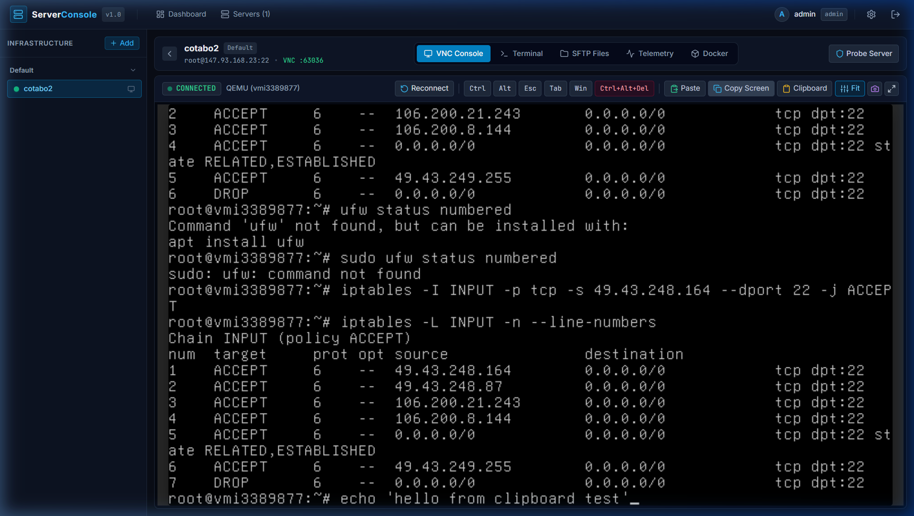
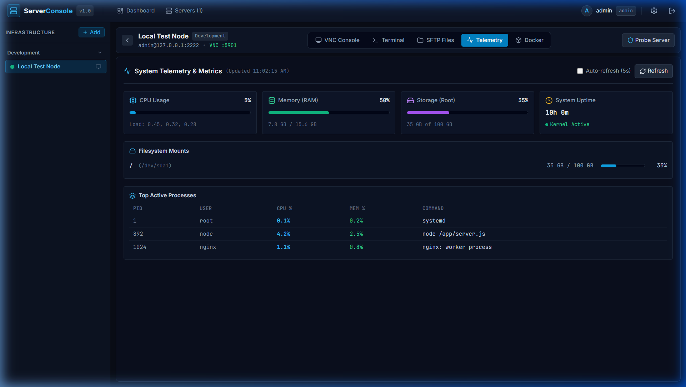
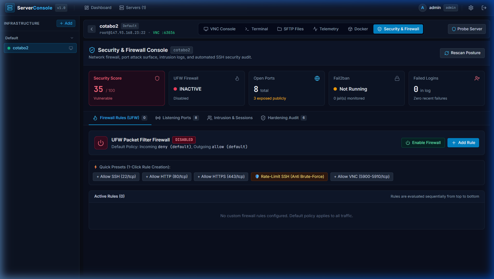
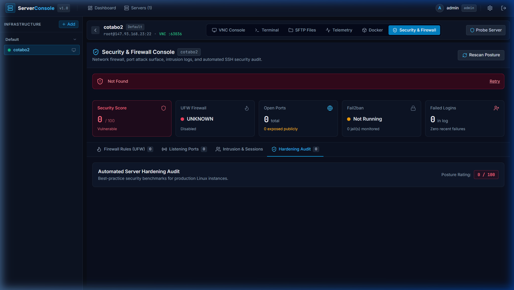
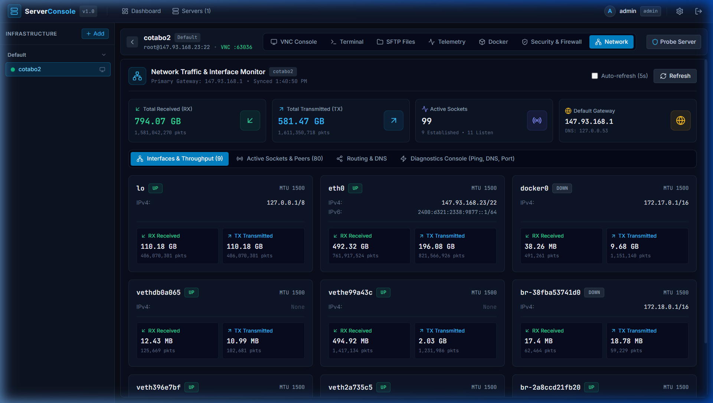
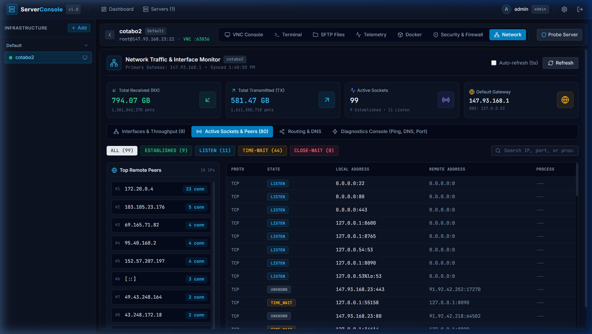
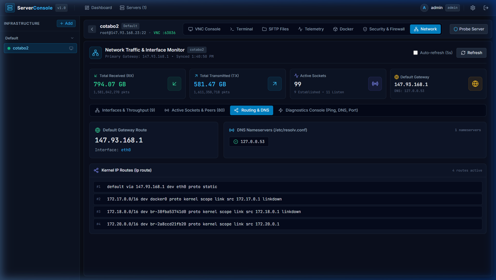
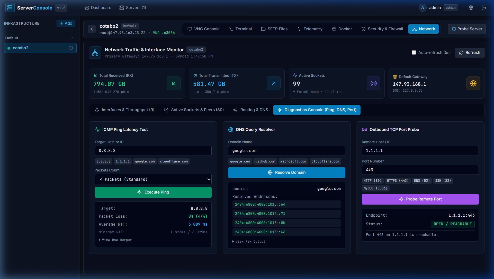

<div align="center">
  

  <h1>IOC — Infrastructure Operations Console</h1>
  <p><strong>Unified Server Management · VNC · SSH · SFTP · Security · Network Analytics</strong></p>

  <p>
    
    
    
    
    
  </p>

  
</div>

---

## 🌐 What is IOC?

**IOC (Infrastructure Operations Console)** is a self-hosted, browser-based server management platform built for DevOps engineers, SREs, and system administrators. It provides a unified workspace to manage entire server fleets — from remote desktop access to security hardening — all from a single, modern web console.

> No third-party cloud required. Runs entirely on your own infrastructure.

---

## ✨ Core Features

### 🖥️ VNC Remote Desktop Console
Connect to any server's graphical desktop directly in the browser via WebSocket-proxied VNC. Full clipboard sync (copy/paste), live video stream, reconnect logic, and Quick-Paste bar for command injection.



---

### 💻 SSH Terminal (Browser-Native)
Full xterm.js-powered SSH terminal with real PTY support, automatic column/row resize, ANSI color rendering, and a persistent WebSocket tunnel. No local SSH client required.

---

### 📁 SFTP File Manager
Drag-and-drop file manager over SFTP. Browse, upload, download, rename, create directories, and delete files — all from the browser. Supports recursive directory deletion.

---

### 📊 System Telemetry & Metrics



Real-time server health monitoring:
- **CPU Usage** — per-core utilization with load averages (1m, 5m, 15m)
- **Memory** — total/used/free RAM and Swap
- **Disk I/O** — per-partition usage with read/write throughput
- **System Info** — hostname, OS distro, kernel version, uptime

---

### 🐳 Docker Container Monitor
Live Docker container overview showing container names, images, status (`running`, `exited`, `paused`), CPU/memory usage, exposed ports, and volume mounts. One-click start/stop/restart actions.

---

### 🛡️ Security & Firewall Console



Comprehensive server hardening dashboard:
- **UFW Firewall** — Enable/disable firewall, view and manage allow/deny rules, add rules by port/protocol/IP/comment
- **Open Port Scanner** — Discover all listening services and their bound addresses
- **Recent SSH Logins** — Audit successful and failed authentication attempts with GeoIP enrichment
- **Fail2Ban Integration** — View active jails, banned IPs, total bans; one-click unban
- **Security Audit & Hardening** — Automated CIS-benchmark checks (SSH root login, password auth, fail2ban, unattended-upgrades, AppArmor, kernel parameters) with remediation recommendations
- **Pending System Updates** — Security and regular package update counts



---

### 🌐 Network Monitoring & Traffic Analytics



Full-stack Linux network observability:

**Interfaces & Throughput**  
Per-interface RX/TX bytes, packet counts, error/drop counters, MTU, IPv4/IPv6, MAC address, and link status (`UP` / `DOWN`) for all physical and virtual interfaces (`eth0`, `docker0`, bridge/veth adapters, `lo`).

**Active Sockets & Peer Tracker**  
Live `ss -ant` socket table with connection state filtering (`ESTABLISHED`, `LISTEN`, `TIME-WAIT`, `CLOSE-WAIT`), per-daemon process association, and Top Remote IPs ranked by connection count.



**Routing Table & DNS Resolver**  
Default gateway, egress interface, kernel IP routing table (`ip route`), and configured DNS nameservers from `/etc/resolv.conf`.



**Interactive Diagnostics Console**  
Run live network diagnostics directly from the server, from your browser:

| Tool | Description |
|------|-------------|
| 🏓 **ICMP Ping** | Packet loss %, min/avg/max RTT, raw output |
| 🔍 **DNS Lookup** | Resolve domain → IP(s), query latency, raw dig output |
| 🔌 **TCP Port Probe** | Test outbound reachability to any host:port |



---

## 🏗️ Architecture

```
ioc/
├── apps/
│   ├── server/          # Fastify API + WebSocket proxy (Node.js)
│   │   └── src/
│   │       ├── routes/  # REST API routes (servers, security, network…)
│   │       └── services/# SSH, VNC, SFTP, Network, Security services
│   └── web/             # React 18 + TypeScript frontend (Vite)
│       └── src/
│           ├── components/  # VNC, Terminal, SFTP, Monitor, Security, Network
│           └── pages/       # Dashboard, ServerDetail
├── packages/
│   └── shared/          # Shared TypeScript types (DTOs, interfaces)
├── data/                # SQLite database (server_console.sqlite)
├── start.ps1            # One-command Windows launcher
├── start.bat            # Shortcut wrapper
└── start.sh             # Linux/macOS launcher
```

**Technology Stack:**

| Layer | Technology |
|-------|-----------|
| Frontend | React 18, TypeScript, Vite, Tailwind CSS, lucide-react |
| Backend | Node.js 22, Fastify, node-ssh2, better-sqlite3 |
| VNC Proxy | WebSocket ↔ TCP bridge (noVNC protocol) |
| Terminal | xterm.js + node-pty (real PTY allocation) |
| SFTP | ssh2-sftp-client over existing SSH session |
| Database | SQLite (zero-dependency, file-based) |
| Auth | JWT + bcrypt, configurable via `admin.config.json` |

---

## 🚀 Quick Start

### Requirements
- Node.js 20+ (LTS recommended)
- npm 9+
- Windows, Linux, or macOS

### One-Command Launch

**Windows:**
```batch
start.bat
```
or with PowerShell:
```powershell
.\start.ps1
```

**Linux / macOS:**
```bash
./start.sh
```

The launcher automatically:
1. ✅ Verifies Node.js & npm
2. ✅ Installs npm workspace dependencies if missing
3. ✅ Builds shared types and server bundle
4. ✅ Creates `.env` with a generated `MASTER_KEY`
5. ✅ Starts backend API (port **3001**)
6. ✅ Starts frontend dev server (port **5173**)
7. ✅ Opens browser automatically

### Default Access

| URL | Service |
|-----|---------|
| `http://localhost:5173` | Web Console |
| `http://localhost:3001/api/health` | Backend Health Check |

> **Credentials** are set via `admin.config.json` in the project root.

---

## ⚙️ Configuration

### `admin.config.json`
```json
{
  "username": "admin",
  "password": "your_secure_password"
}
```

### `.env`
```env
PORT=3001
NODE_ENV=development
JWT_SECRET=generated_automatically
MASTER_KEY=generated_automatically
DATABASE_PATH=./data/server_console.sqlite
```

---

## 🖥️ Adding Your First Server

1. Open the IOC console at `http://localhost:5173`
2. Login with your credentials
3. Click **"+ Add"** in the sidebar
4. Fill in:
   - **Server name** (e.g. `prod-web-01`)
   - **Host / IP address**
   - **SSH username & password** (or upload a private key)
   - **VNC host & port** (optional, for remote desktop)
5. Click **"Save"** — IOC will test connectivity immediately

---

## 🔒 Security Notes

- All server credentials are **encrypted at rest** using AES-256-GCM with the `MASTER_KEY` from `.env`
- JWT tokens expire after **7 days** (configurable)
- The application is designed for **private network / VPN use**
- Do **not** expose port 3001 or 5173 directly to the public internet without a reverse proxy with TLS

---

## 📦 Development

```bash
# Install dependencies
npm install

# Build shared types
npm run build --workspace=@server-console/shared

# Run backend in dev mode (hot-reload)
npm run dev --workspace=@server-console/server

# Run frontend in dev mode
npm run dev --workspace=@server-console/web

# Run all tests
npm test
```

---

## 🧪 Tests

19 automated tests covering:
- Auth API (setup, login, JWT validation)
- Server CRUD operations
- SSH/VNC connection probing
- System telemetry endpoints
- Docker container monitoring
- Security overview & firewall API
- Network telemetry & diagnostics (ping, DNS, port probe)

```bash
npm test
# → 19 passed (2 test files)
```

---

## 📄 License

MIT License — see [LICENSE](LICENSE) for details.

---

<div align="center">
  <p>Built with ❤️ for engineers who manage real infrastructure.</p>
  <p>
    <strong>IOC — Infrastructure Operations Console</strong><br/>
    <em>One console. All your servers. Fully under your control.</em>
  </p>
  
</div>
