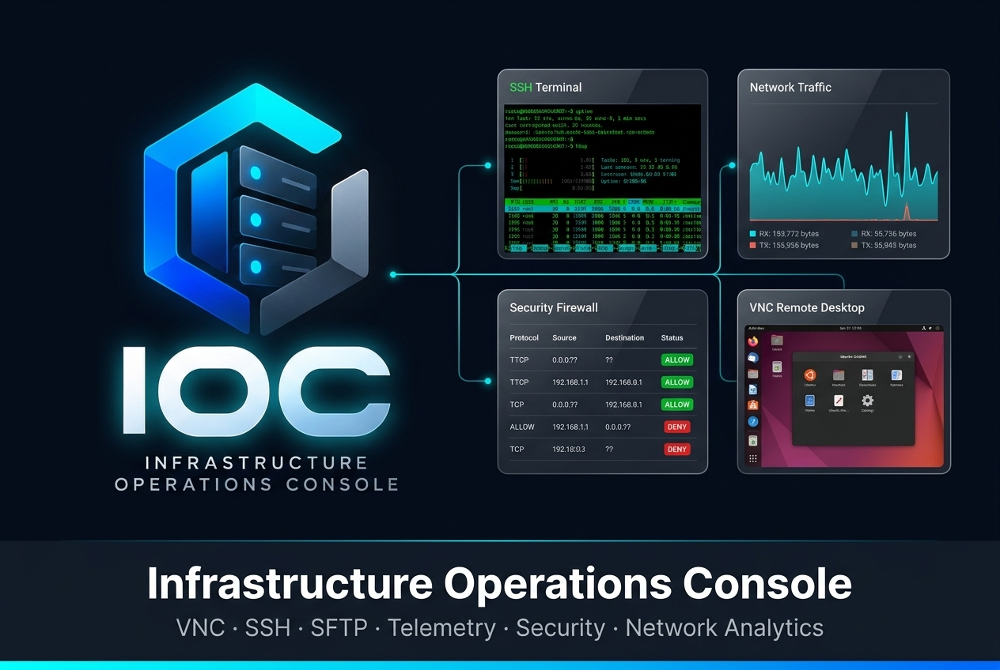

<div align="center">
  

  <h1>IOC — Infrastructure Operations Console</h1>
  <p><strong>Unified Server Management · VNC · SSH · SFTP · Security · Network Analytics</strong></p>

  <p>
    
    
    
    
    
  </p>

  
</div>

---

## 🌐 What is IOC?

**IOC (Infrastructure Operations Console)** is a self-hosted, browser-based server management platform built for DevOps engineers, SREs, and system administrators. It provides a unified workspace to manage entire server fleets — from remote desktop access to security hardening — all from a single, modern web console.

> No third-party cloud required. Runs entirely on your own infrastructure.

---

## ✨ Core Features

### 🖥️ VNC Remote Desktop Console
Connect to any server's graphical desktop directly in the browser via WebSocket-proxied VNC:
- **RFB 3.8 Protocol Bridge** — Real-time frame buffer streaming with hardware-accelerated canvas rendering.
- **Bi-Directional Clipboard** — Live copy/paste synchronization between browser and remote session.
- **Quick-Paste & Macros** — 1-click execution for administrative shortcuts (`Ctrl+Alt+Del`, `Win`, `Esc`, `Tab`, command injection).
- **Auto-Scale & Fullscreen** — Dynamic viewport fitting and seamless low-latency reconnect logic.

---

### 💻 SSH Terminal (Browser-Native)
Full xterm.js-powered SSH terminal running on real Linux PTY pseudo-terminals over a persistent WebSocket tunnel:
- **Multi-Tab Workspace** — Run multiple concurrent terminal sessions per server without losing state.
- **Snippets Library** — Store, organize, and execute reusable shell commands across your fleet.
- **Terminal Capabilities** — 256 ANSI colors, mouse events, dynamic column/row resizing, and clipboard integration.

---

### 📁 SFTP File Manager
High-performance SFTP file browser built directly into the web console:
- **File Operations** — Upload, download, rename, preview, and recursively delete files and directories.
- **Integrated Code Editor** — Edit remote configuration files (`nginx.conf`, `.env`, systemd units) directly in-browser.
- **Drag-and-Drop** — Instant multi-file uploads with progress tracking.

---

### 📊 System Telemetry & Metrics
Real-time Linux telemetry streamed over WebSocket with zero polling overhead:
- **CPU Utilization** — Per-core load metrics, usage percentages, and system load averages (1m, 5m, 15m).
- **Memory & Swap** — Real-time breakdown of total, used, free RAM, cache buffers, and swap usage.
- **Disk & Mounts** — Per-partition disk utilization with live read/write I/O throughput.
- **Historical Metrics** — 7-day retention database with interactive sparklines and capacity trending.

---

### 🐳 Docker Container Monitor
Full visibility into local and remote Docker engines:
- **Container Fleet Status** — Real-time monitoring of all running, exited, and paused containers.
- **Resource Analytics** — Per-container CPU%, RAM footprint, mapped network ports, and volume bindings.
- **Lifecycle Management** — 1-click Start, Stop, Restart, and live log stream following.

---

### 🛡️ Security & Firewall Console
Comprehensive server hardening dashboard following CIS-benchmark recommendations:
- **UFW Firewall Controller** — Enable/disable firewall, manage inbound/outbound rules by port/protocol/IP, with 1-click anti-brute-force rate limiting.
- **Open Port Scanner** — Instant discovery of all listening daemons, bound network interfaces, and socket states.
- **Authentication Audits** — GeoIP-enriched tracking of successful and failed SSH login attempts.
- **Fail2Ban Integration** — View active jails, inspect banned IPs, and trigger 1-click IP unbans.
- **Automated Hardening Checks** — Evaluates SSH root login, password auth, unattended upgrades, AppArmor, and sysctl hardening.

---

### 🌐 Network Monitoring & Traffic Analytics
Full-stack Linux network observability and remote diagnostic tooling:
- **Interfaces & Throughput** — Live RX/TX throughput rates, cumulative bandwidth, MTU, and packet error/drop counters.
- **Active Sockets & Peer Tracker** — Real-time socket inspector (`ss -ant`) with connection filtering (`ESTABLISHED`, `LISTEN`, `TIME-WAIT`) and remote IP peer ranking.
- **Routing & DNS Resolver** — Inspect default gateway routes, kernel routing tables (`ip route`), and system nameservers (`/etc/resolv.conf`).
- **In-Browser Diagnostics** — Run ICMP Ping tests, DNS queries, and outbound TCP Port Probes directly from remote host targets:

| Tool | Capability | Metrics Provided |
|------|------------|------------------|
| 🏓 **ICMP Ping** | Outbound host reachability test | Packet loss %, min/avg/max RTT, raw ping output |
| 🔍 **DNS Lookup** | Query domain nameservers | IP address resolution, query latency, raw dig output |
| 🔌 **TCP Port Probe** | Test outbound firewall reachability | Connection status (`OPEN` / `CLOSED`), handshake latency |

---

### ⚡ Real-time Updates
Telemetry, network throughput (live ↓/↑ rates), Docker state, server status and alerts are **pushed over a WebSocket** (`/api/live`) - no polling, no refresh button. A LIVE badge shows connection health and reconnects automatically; polling on the server only runs while someone is watching.

### 📈 Metrics History & Alerting
A background collector samples every server each minute (`METRICS_INTERVAL_SEC`), keeps 7 days of history for sparklines and charts, and evaluates **alert rules** (CPU, memory, disk, load, unreachable - sustained for N minutes). Alerts notify **Telegram, Discord, Slack or any webhook** on fire and on recovery.

### ⚙️ Services, Logs & Docker Actions
Browse and start/stop/restart **systemd services**, search **journal / unit / `/var/log` / container logs** with live follow, and control Docker containers - all with input validation and audit logging.

### 📜 Runbooks
Save shell scripts, run them on one server, a group or all servers (manually or on an interval), and review per-server output and exit codes.

### 🧩 Plugins
Drop-in extensions with approved permissions, their own pages and API endpoints. Ships with an **Uptime & SSL checker** and a **Prometheus exporter**. See [docs/plugins.md](docs/plugins.md).

### 🔐 Access Control
Roles (viewer / operator / admin), user management, **TOTP 2FA** with recovery codes, **API tokens**, login throttling, and **SSH host-key pinning**. See [docs/security.md](docs/security.md).

### 🤖 AI Assistant (optional)
Set `ANTHROPIC_API_KEY` to get advice-only health analysis of a server snapshot (secrets redacted, consent required, never executes commands).

### 🖱️ Multi-tab Terminal
Several independent SSH shells per server that stay alive while you browse other tabs.

---

## 🏗️ Architecture

```
ioc/
├── apps/
│   ├── server/          # Fastify API + WebSocket proxy (Node.js)
│   │   └── src/
│   │       ├── routes/  # REST API routes (servers, security, network…)
│   │       └── services/# SSH, VNC, SFTP, Network, Security services
│   └── web/             # React 18 + TypeScript frontend (Vite)
│       └── src/
│           ├── components/  # VNC, Terminal, SFTP, Monitor, Security, Network
│           └── pages/       # Dashboard, ServerDetail
├── packages/
│   └── shared/          # Shared TypeScript types (DTOs, interfaces)
├── data/                # SQLite database (server_console.sqlite)
├── start.ps1            # One-command Windows launcher
├── start.bat            # Shortcut wrapper
└── start.sh             # Linux/macOS launcher
```

**Technology Stack:**

| Layer | Technology |
|-------|-----------|
| Frontend | React 18, TypeScript, Vite, Tailwind CSS, lucide-react |
| Backend | Node.js 22, Fastify, node-ssh2, better-sqlite3 |
| VNC Proxy | WebSocket ↔ TCP bridge (noVNC protocol) |
| Terminal | xterm.js + node-pty (real PTY allocation) |
| SFTP | ssh2-sftp-client over existing SSH session |
| Database | SQLite (zero-dependency, file-based) |
| Auth | JWT + bcrypt, configurable via `admin.config.json` |

---

## 🚀 Quick Start

### Requirements
- Node.js 20+ (LTS recommended)
- npm 9+
- Windows, Linux, or macOS

### One-Command Launch

**Windows:**
```batch
start.bat
```
or with PowerShell:
```powershell
.\start.ps1
```

**Linux / macOS:**
```bash
./start.sh
```

The launcher automatically:
1. ✅ Verifies Node.js & npm
2. ✅ Installs npm workspace dependencies if missing
3. ✅ Builds shared types and server bundle
4. ✅ Creates `.env` with a generated `MASTER_KEY`
5. ✅ Starts backend API (port **3001**)
6. ✅ Starts frontend dev server (port **5173**)
7. ✅ Opens browser automatically

### Default Access

| URL | Service |
|-----|---------|
| `http://localhost:5173` | Web Console |
| `http://localhost:3001/api/health` | Backend Health Check |

> **Credentials** are set via `admin.config.json` in the project root.

---

## ⚙️ Configuration

### `admin.config.json`
```json
{
  "username": "admin",
  "password": "your_secure_password"
}
```

### `.env`
```env
PORT=3001
NODE_ENV=development
HOST=127.0.0.1                  # 0.0.0.0 to listen on the network (use TLS!)
JWT_SECRET=generated_automatically
MASTER_KEY=generated_automatically
DATABASE_PATH=./data/server_console.sqlite
METRICS_INTERVAL_SEC=60         # background telemetry sampling (min 15)
PLUGINS_DIR=./plugins
COOKIE_SECURE=false             # true behind HTTPS
ANTHROPIC_API_KEY=              # optional: enables the AI assistant
```

---

## 🖥️ Adding Your First Server

1. Open the IOC console at `http://localhost:5173`
2. Login with your credentials
3. Click **"+ Add"** in the sidebar
4. Fill in:
   - **Server name** (e.g. `prod-web-01`)
   - **Host / IP address**
   - **SSH username & password** (or upload a private key)
   - **VNC host & port** (optional, for remote desktop)
5. Click **"Save"** — IOC will test connectivity immediately

---

## 🔒 Security Notes

- All server credentials are **encrypted at rest** using AES-256-GCM with the `MASTER_KEY` from `.env` (if none is set, a random key is generated into `data/secrets.json` - **back it up**)
- **Change the default `admin` / `admin1234` credentials** in `admin.config.json` before exposing the console to anyone else
- JWT tokens expire after **7 days** (configurable)
- The backend listens on `127.0.0.1` by default; set `HOST=0.0.0.0` only behind a TLS reverse proxy (and `COOKIE_SECURE=true`)
- The application is designed for **private network / VPN use**
- Do **not** expose port 3001 or 5173 directly to the public internet without a reverse proxy with TLS

---

## 📦 Development

```bash
# Install dependencies
npm install

# Build shared types
npm run build --workspace=@server-console/shared

# Run backend in dev mode (hot-reload)
npm run dev --workspace=@server-console/server

# Run frontend in dev mode
npm run dev --workspace=@server-console/web

# Run all tests
npm test
```

---

## 🧪 Tests

Automated tests covering:
- Auth API (setup, login, JWT validation)
- Server CRUD operations
- SSH/VNC connection probing
- System telemetry endpoints
- Docker container monitoring
- Security overview & firewall API
- Network telemetry & diagnostics (ping, DNS, port probe)
- Role policy, alert engine, login throttling
- TOTP (RFC 6238 vectors), API tokens, 2FA recovery codes, last-admin protection
- Shell-injection guards for logs, services, containers, firewall and fail2ban inputs

```bash
npm test
```

---

## 📄 License

MIT License — see [LICENSE](LICENSE) for details.

---

<div align="center">
  <p>Built with ❤️ for engineers who manage real infrastructure.</p>
  <p>
    <strong>IOC — Infrastructure Operations Console</strong><br/>
    <em>One console. All your servers. Fully under your control.</em>
  </p>
  
</div>
